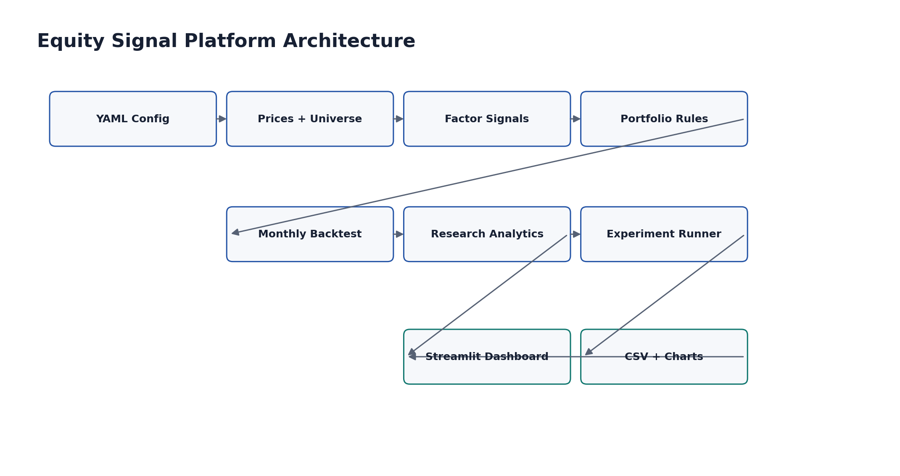
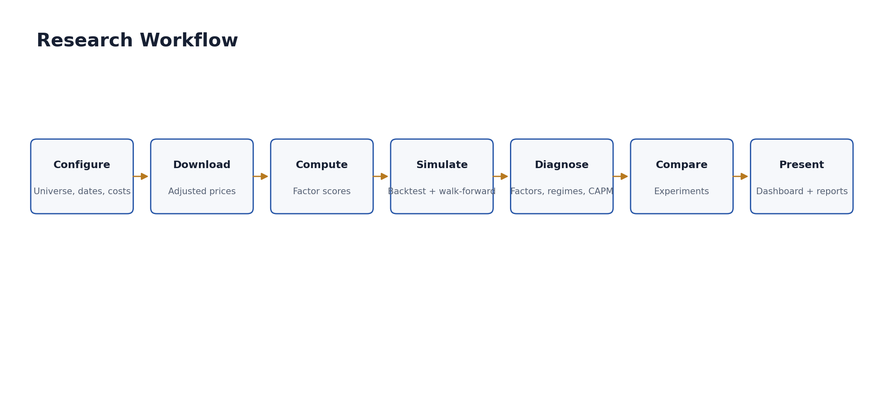
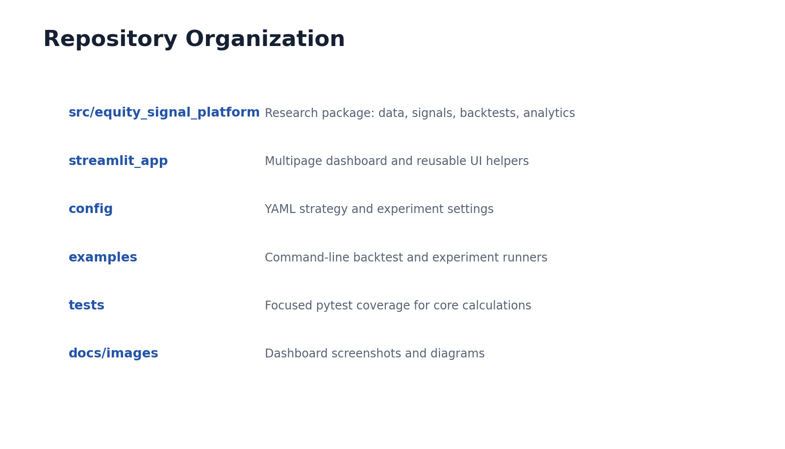
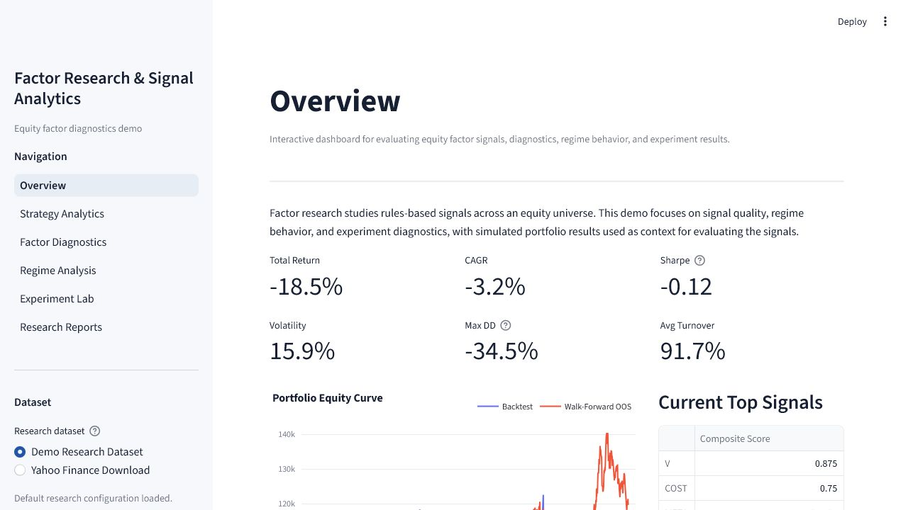
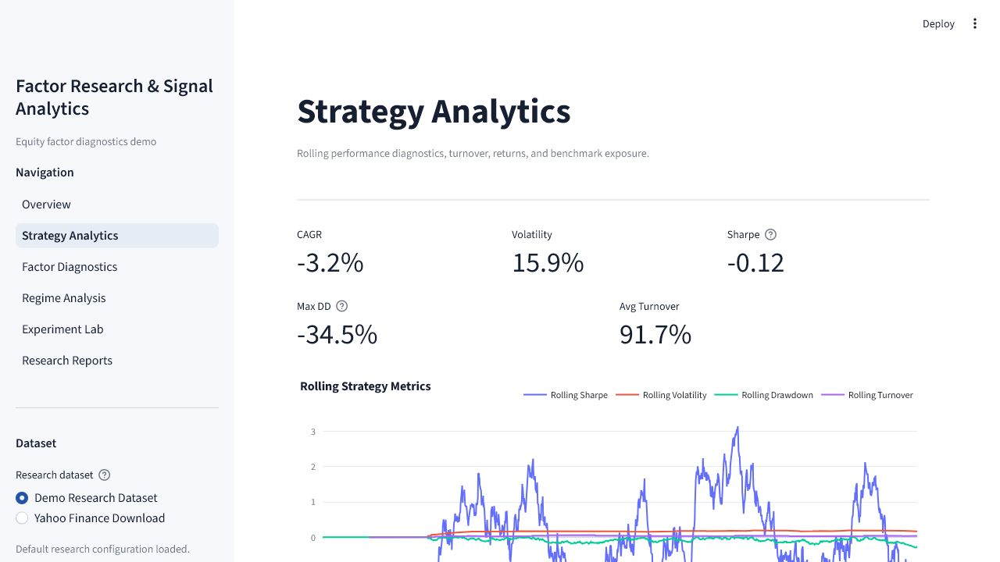
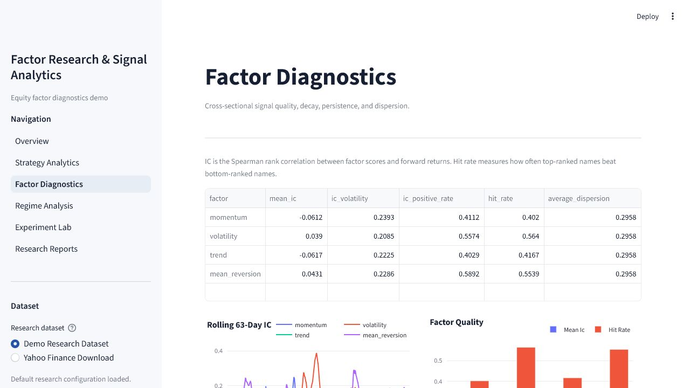
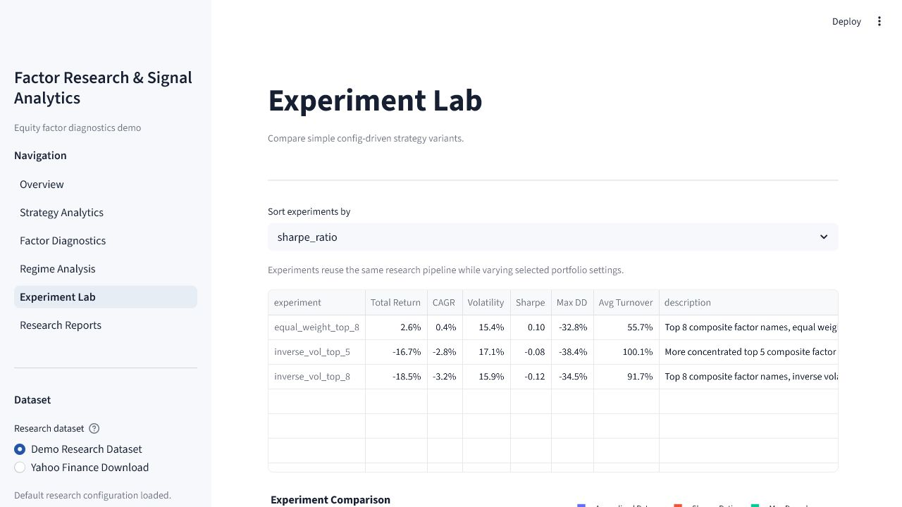

# Factor Research & Signal Analytics Platform

Interactive dashboard for evaluating equity factor signals, diagnostics, regime behavior, and experiment results.

This project is built for portfolio review and quant internship recruiting. It is intentionally readable and modest in scope: the goal is to show a defensible signal research workflow, not to present production trading infrastructure or claim predictive performance.

## Disclaimer

This repository is for education and research demonstration only. It is not investment advice, a recommendation engine, or a live trading system. Backtest results are hypothetical and depend on data quality, assumptions, and parameter choices. No result in this project should be interpreted as evidence of future profitability.

## Features

- Starter large-cap U.S. equity universe
- Price download with `yfinance`
- Optional synthetic demo data for fast dashboard previews
- Momentum, volatility, trend, and mean reversion factor signals
- Equal-weight and inverse-volatility portfolio construction
- Monthly rebalance simulation used to evaluate signal behavior with transaction cost and slippage assumptions
- Walk-forward train/test evaluation using historical information coefficients
- SPY-based bull/bear and high/low volatility regime analysis
- Rolling Sharpe, volatility, drawdown, returns, and turnover
- Factor diagnostics: information coefficient, hit rate, decay, persistence, and dispersion
- CAPM regression against a benchmark return series
- Lightweight config-driven experiment runner
- Multipage Streamlit dashboard for signal diagnostics and report downloads
- Focused pytest coverage for core calculations

## Architecture



```text
equity-signal-platform/
|-- .streamlit/                 # Streamlit theme/navigation settings
|-- config/                     # YAML configuration
|-- docs/images/                # Screenshots and diagrams
|-- examples/                   # CLI workflows
|-- src/equity_signal_platform/ # Research package
|-- streamlit_app/              # Multipage dashboard
|-- tests/                      # Unit tests
|-- requirements.txt
|-- runtime.txt
`-- README.md
```

The code is organized around a simple research pipeline:

1. Load configuration and universe.
2. Load either Yahoo Finance prices or deterministic demo prices.
3. Compute factor signals from historical prices.
4. Construct long-only portfolios at monthly rebalance dates.
5. Simulate returns with cost and slippage assumptions to contextualize signal behavior.
6. Evaluate performance, factor diagnostics, regimes, regressions, and experiments.
7. Present results through the dashboard and saved report artifacts.





## Screenshots









## Installation

```bash
git clone https://github.com/johnA750/Equity-Signal-Platform.git
cd Equity-Signal-Platform
python -m venv .venv
.venv\Scripts\activate
python -m pip install --upgrade pip
pip install -r requirements.txt
pip install -e .
```

On macOS or Linux:

```bash
source .venv/bin/activate
```

## Dashboard

Launch the dashboard:

```bash
streamlit run streamlit_app/app.py
```

The sidebar includes a **Use fast demo data** toggle. Demo mode uses deterministic synthetic prices so the dashboard loads quickly for portfolio reviewers without relying on network access. Turn it off to use Yahoo Finance data.

Dashboard pages:

- Overview: summary metrics, equity curve, drawdown, top signals, latest experiments
- Strategy Analytics: rolling metrics, monthly return heatmap, CAPM summary
- Factor Diagnostics: IC, hit rate, factor decay, persistence, dispersion
- Regime Analysis: performance by market and volatility regime
- Experiment Lab: experiment comparison, parameters, metadata, walk-forward windows
- Research Reports: generated PNG and CSV artifacts

## Command-Line Workflows

Run a full research backtest:

```bash
python examples/run_backtest.py --config config/default.yaml
```

Run configured experiment variants:

```bash
python examples/run_experiments.py --config config/default.yaml
```

Run tests:

```bash
pytest
```

## Configuration

The main configuration file is `config/default.yaml`. It controls:

- date range
- universe
- factor lookbacks
- factor weights
- portfolio weighting method
- transaction cost and slippage assumptions
- walk-forward train/test windows
- regime classification settings
- experiment definitions

## Methodology Notes

### Signals

The platform currently uses four price-based signals:

- Momentum: trailing return with a short skip period
- Volatility: trailing realized volatility, ranked lower-is-better
- Trend: price relative to moving average
- Mean reversion: short-term trailing return, ranked lower-is-better

Signals are ranked cross-sectionally before combination. This keeps scale differences from dominating the composite score.

### Backtesting

The backtest is monthly, long-only, and portfolio-level. Signals are computed using information available at the rebalance date, then holdings are shifted forward before applying returns. This is intended to avoid same-close look-ahead in the simulation.

Transaction costs and slippage are simple basis-point assumptions applied to turnover. They are not a market-impact model.

### Walk-Forward Evaluation

Walk-forward testing estimates factor weights from a rolling training window, then applies those fixed weights to the next test window. The default setup trains on 36 months and tests on 12 months. This is useful for reducing in-sample overfitting, but it does not eliminate data snooping or parameter selection bias.

### Regime Analysis

SPY is used as a simple benchmark for regime classification. Bull/bear regimes compare SPY to a moving average. Volatility regimes compare realized volatility to a rolling quantile threshold.

### Factor Diagnostics

The factor diagnostics are deliberately simple and explainable:

- Information coefficient: Spearman rank correlation between signal scores and forward returns
- Hit rate: frequency that the top-half ranked names outperform the bottom-half ranked names
- Factor decay: average IC across multiple forward-return horizons
- Signal persistence: rank autocorrelation across configurable lags
- Dispersion: cross-sectional separation of raw factor values

## Data Quality And Bias Caveats

- Yahoo Finance data is convenient but not institutional-grade.
- Adjusted prices may be revised and can contain missing or stale observations.
- The default universe is static and therefore subject to survivorship bias.
- The platform does not model historical index membership changes.
- The project does not include delisted stocks, corporate action validation, borrow costs, taxes, liquidity constraints, or capacity analysis.
- Results can be sensitive to lookback windows, rebalance timing, costs, and universe selection.
- Experiment comparison can encourage overfitting if many variants are tried and only the best is highlighted.

## Deployment

The repository is ready for Streamlit Community Cloud:

- Entry point: `streamlit_app/app.py`
- Dependencies: `requirements.txt`
- Python version hint: `runtime.txt`
- Streamlit settings: `.streamlit/config.toml`
- Demo mode avoids mandatory network access on first load

Suggested deployment steps:

1. Push the repository to GitHub.
2. Create a Streamlit Community Cloud app.
3. Set the main file path to `streamlit_app/app.py`.
4. Leave demo mode enabled for public portfolio review.
5. Add a short note in the app description that results are simulated and educational.

## Technical Design Philosophy

- Prefer transparent pandas calculations over opaque abstractions.
- Keep modules small enough to explain in interviews.
- Separate data, signals, portfolio construction, backtesting, analytics, experiments, and dashboard code.
- Use config-driven experiments without introducing unnecessary services or infrastructure.
- Favor statistical caveats and reproducibility over marketing-style claims.

## Future Roadmap

- Point-in-time universe membership
- Delisted security handling
- Fundamental data factors
- Sector and beta neutrality
- Risk model integration
- More realistic transaction cost and market impact assumptions
- Fama-French factor data loader
- Exportable tear sheets
- More systematic parameter search with proper validation discipline

## Public Release Checklist

- Confirm `pytest` passes.
- Confirm `pip check` passes.
- Confirm dashboard starts with `streamlit run streamlit_app/app.py`.
- Confirm demo mode loads without network access.
- Review screenshots in `docs/images/`.
- Keep `data/`, `reports/`, `.venv/`, caches, and package metadata out of git.
- Avoid presenting backtest outputs as expected future returns.
