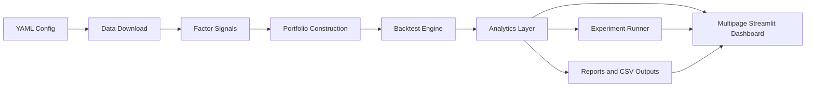

# Equity Signal Platform

A Python research platform for downloading equity data, building cross-sectional factor signals, backtesting systematic portfolios, evaluating experiments, and presenting results in a polished Streamlit research dashboard.

This project is designed for quant research recruiting conversations. It favors readable methodology, out-of-sample evaluation, and defensible assumptions over production trading complexity. It is a research and simulation tool only, not a live trading bot or investment recommendation system.

## What It Does

- Downloads adjusted daily prices with `yfinance`
- Defines a starter large-cap U.S. equity universe
- Computes momentum, volatility, trend, and mean reversion signals
- Builds equal-weight or inverse-volatility portfolios
- Runs monthly rebalance backtests with transaction costs and slippage
- Runs rolling walk-forward train/test evaluations
- Classifies SPY-based bull/bear and high/low volatility regimes
- Computes rolling Sharpe, volatility, drawdown, returns, and turnover
- Evaluates factor IC, hit rate, decay, persistence, and dispersion
- Estimates CAPM alpha/beta and supports generic factor regression inputs
- Runs lightweight config-driven experiments and compares results
- Produces charts, CSV outputs, and a multipage Streamlit dashboard

## Project Structure

```text
equity-signal-platform/
|-- .streamlit/
|   `-- config.toml
|-- config/
|   `-- default.yaml
|-- docs/
|   `-- images/
|-- examples/
|   |-- run_backtest.py
|   `-- run_experiments.py
|-- src/
|   `-- equity_signal_platform/
|       |-- analytics/
|       |-- backtesting/
|       |-- data/
|       |-- experiments/
|       |-- portfolio/
|       |-- reporting/
|       |-- signals/
|       `-- universe.py
|-- streamlit_app/
|   |-- app.py
|   |-- dashboard/
|   `-- pages/
|-- tests/
|-- requirements.txt
|-- runtime.txt
`-- README.md
```

## Project Architecture



## Installation

```bash
git clone https://github.com/johnA750/Equity-Signal-Platform.git
cd Equity-Signal-Platform
python -m venv .venv
.venv\Scripts\activate
python -m pip install --upgrade pip
pip install -r requirements.txt
pip install -e .
```

On macOS or Linux, activate the environment with:

```bash
source .venv/bin/activate
```

## Run A Backtest

```bash
python examples/run_backtest.py --config config/default.yaml
```

Outputs are written to `reports/`, including:

- `backtest_results.csv`
- `performance_summary.csv`
- `latest_signal_ranks.csv`
- `rolling_metrics.csv`
- `factor_summary.csv`
- `capm_regression.csv`
- `walk_forward_returns.csv`
- `*_regime_summary.csv`
- chart PNG files

## Run Experiments

The default config includes three simple experiment definitions:

```bash
python examples/run_experiments.py --config config/default.yaml
```

Outputs are written to `reports/experiments/`:

- `experiment_comparison.csv`
- Per-experiment `summary.csv`
- Per-experiment `returns.csv`
- Per-experiment `rolling_metrics.csv`
- Per-experiment `metadata.json`

## Launch The Dashboard

```bash
streamlit run streamlit_app/app.py
```

## Dashboard Overview

The dashboard is organized as a Streamlit multipage research interface:

- Overview: platform summary, key metrics, latest experiments, equity curve, drawdown, and top signals
- Strategy Analytics: rolling Sharpe, volatility, drawdown, turnover, rolling returns, monthly return heatmap, and CAPM table
- Factor Diagnostics: IC charts, hit rate, decay, persistence, dispersion, and current rankings
- Regime Analysis: bull/bear and high/low volatility performance tables and charts
- Experiment Lab: sortable experiment comparison, parameter comparison, metadata, and walk-forward windows
- Research Reports: generated charts, CSV downloads, and experiment artifacts

The dashboard uses shared cached data loading in `streamlit_app/dashboard/data.py`, reusable chart helpers in `streamlit_app/dashboard/charts.py`, and one page file per research area in `streamlit_app/pages/`.

## Screenshots


## Methodology

The default strategy is a monthly rebalanced long-only factor portfolio. The research workflow separates signal estimation, portfolio construction, simulation, diagnostics, and experiment comparison.

1. Daily adjusted close prices are downloaded from Yahoo Finance through `yfinance`.
2. Daily returns are calculated from adjusted prices.
3. Factor signals are estimated from information available at each date:
   - Momentum: trailing return over a configurable lookback, skipping the most recent month by default.
   - Volatility: trailing realized volatility, ranked lower-is-better.
   - Trend: price versus moving average.
   - Mean reversion: short-term trailing return, ranked lower-is-better.
4. Month-end signal ranks select top names.
5. Portfolio weights are formed using either equal weight or inverse volatility.
6. Rebalance weights are applied to future returns, avoiding same-close look-ahead.
7. Transaction costs and slippage are charged based on turnover.

## Research Workflow

1. Configure universe, dates, factor parameters, portfolio construction, and experiment variants in `config/default.yaml`.
2. Run `python examples/run_backtest.py --config config/default.yaml` to produce full diagnostics and report files.
3. Run `python examples/run_experiments.py --config config/default.yaml` to compare strategy variants.
4. Launch `streamlit run streamlit_app/app.py` to inspect results interactively.
5. Use the dashboard reports page to review generated PNG and CSV artifacts.

### Walk-Forward Evaluation

Walk-forward testing estimates factor weights from a rolling training window and applies those fixed weights to the next test window. The default setup trains on 36 months and tests on the next 12 months. Factor weights are estimated from positive historical information coefficients. Test-window returns are concatenated into an out-of-sample equity curve.

### Regime Analysis

The platform downloads SPY as the default benchmark. Bull/bear regimes are classified by whether SPY is above or below its moving average. Volatility regimes compare short-term realized volatility to a rolling historical quantile. Strategy performance is summarized by market, volatility, and combined regimes.

### Factor Diagnostics

- Information coefficient: Spearman rank correlation between signal scores and forward returns
- Hit rate: frequency that top-half ranked names outperform bottom-half ranked names
- Factor decay: average IC across several forward-return horizons
- Signal persistence: rank autocorrelation across configurable lags
- Dispersion: cross-sectional standard deviation of signal scores

### Regression Analysis

CAPM regression estimates annualized alpha, market beta, R-squared, and t-statistics versus benchmark returns. A generic factor regression helper is included for user-supplied factor return data such as Fama-French factors.

### Experiment Framework

Experiments are defined in `config/default.yaml`. Each experiment overrides selected base settings, runs the same research workflow, saves metadata, and contributes to a comparison table. This keeps strategy variants reproducible without adding heavyweight infrastructure.

## Deployment Preparation

The repository is structured for Streamlit Community Cloud:

- App entrypoint: `streamlit_app/app.py`
- Dependencies: `requirements.txt`
- Python version hint: `runtime.txt`
- Streamlit theme/navigation config: `.streamlit/config.toml`
- No credentials or live trading keys are required

Suggested deployment steps:

1. Push the repository to GitHub.
2. Create a new Streamlit Community Cloud app from the repo.
3. Set the main file path to `streamlit_app/app.py`.
4. Let Streamlit install dependencies from `requirements.txt`.
5. Present the app as a research simulation dashboard, not an investment advice product.

## Limitations

- Yahoo Finance data may contain survivorship bias, missing data, stale prices, or adjusted price revisions.
- The starter universe is static and does not model index membership changes through time.
- Walk-forward tests reduce overfitting risk but do not eliminate data snooping.
- CAPM and factor regressions are historical estimates and depend on model assumptions.
- The model is long-only and does not include borrow costs, shorting constraints, taxes, market impact, or capacity analysis.
- Transaction cost and slippage assumptions are simplified.
- Results are for research and education. They do not imply future performance or guaranteed profitability.

## Future Roadmap

- Point-in-time universe membership
- Fundamental and alternative data factors
- Sector and beta neutrality
- Risk model integration
- More realistic execution simulation
- Richer parameter sweeps and experiment tracking
- Exportable tear sheets
- Fama-French factor data loader
- Optional private-data support through Streamlit secrets

## Development

Run tests with:

```bash
pytest
```
